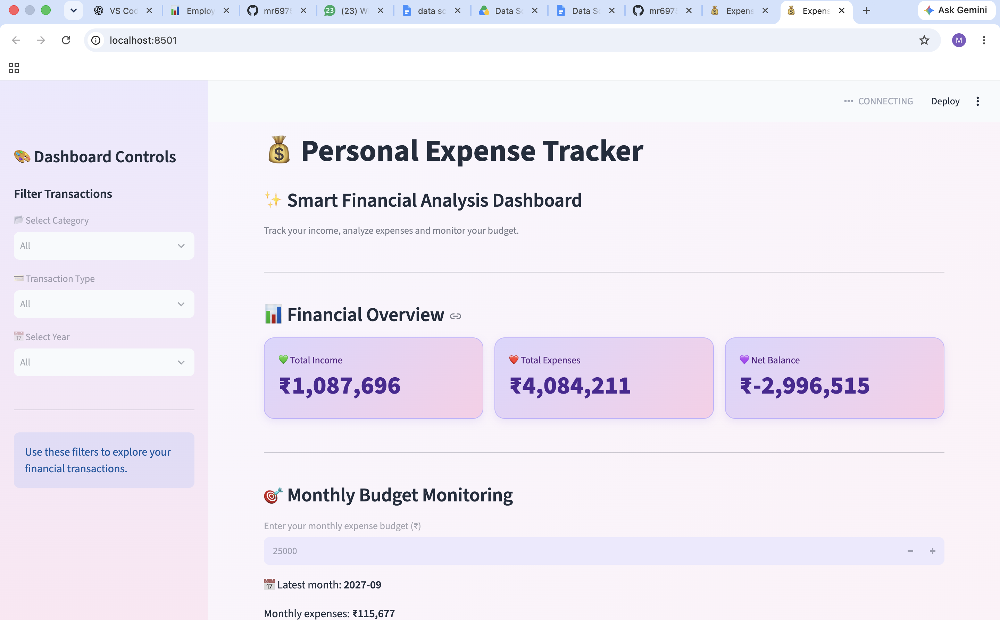

# 💰 Personal Expense Tracker Using Data Science

## 📌 Project Overview

The Personal Expense Tracker is a Python-based data science project that analyzes income and expenses using data analysis and visualization techniques.

It provides an interactive dashboard using Streamlit to help users understand spending patterns and monitor budgets.

## 🎯 Objectives

- Track income and expenses.
- Analyze category-wise spending.
- Visualize monthly expense trends.
- Monitor monthly budgets.
- Explore transactions using interactive filters.

## 🛠️ Technologies Used

- Python
- Pandas
- NumPy
- Matplotlib
- Seaborn
- Streamlit

## 📂 Project Structure

Expense-Tracker-App/
- data/
- src/
  - generate_data.py
  - clean_data.py
  - analysis.py
- outputs/
  - charts/
- app.py
- requirements.txt
- README.md

## ⚙️ Features

1. Synthetic transaction data generation.
2. Data cleaning and preprocessing.
3. Financial summary analysis.
4. Category-wise expense visualization.
5. Monthly expense trend analysis.
6. Payment method analysis.
7. Interactive Streamlit dashboard.
8. Monthly budget monitoring.
9. CSV download functionality.

## 🚀 How to Run

### 1. Clone the repository

git clone YOUR_GITHUB_REPOSITORY_URL

### 2. Open the project folder

cd Expense-Tracker-App

### 3. Create a virtual environment

python3 -m venv venv

### 4. Activate the environment

source venv/bin/activate

### 5. Install dependencies

pip install -r requirements.txt

### 6. Generate sample data

python3 src/generate_data.py

### 7. Clean the data

python3 src/clean_data.py

### 8. Run data analysis

python3 src/analysis.py

### 9. Launch the dashboard

python3 -m streamlit run app.py

## 📊 Dataset

The project uses 1,000 synthetically generated transactions.

Columns include:
- Date
- Category
- Amount
- Type
- Payment_Method
- Description

## 📌 Future Improvements

- Add user authentication.
- Add custom date filters.
- Add monthly and yearly reports.
- Support uploading personal CSV files.
- Improve budget recommendations.

## 👩‍💻 Author

Meghana

## ⚠️ Disclaimer

This project uses synthetic sample data for educational and demonstration purposes.

## Dashboard Preview

